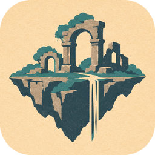
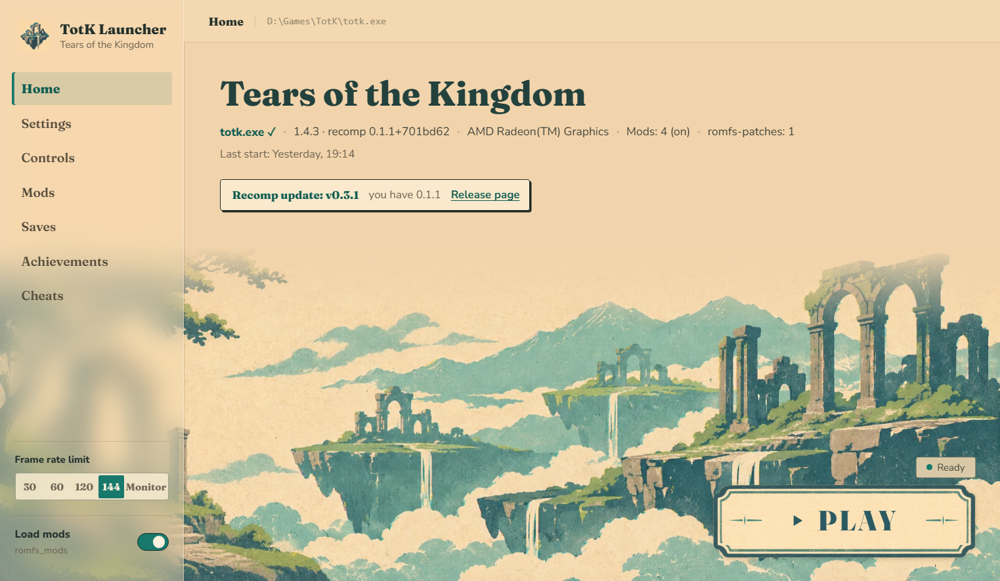
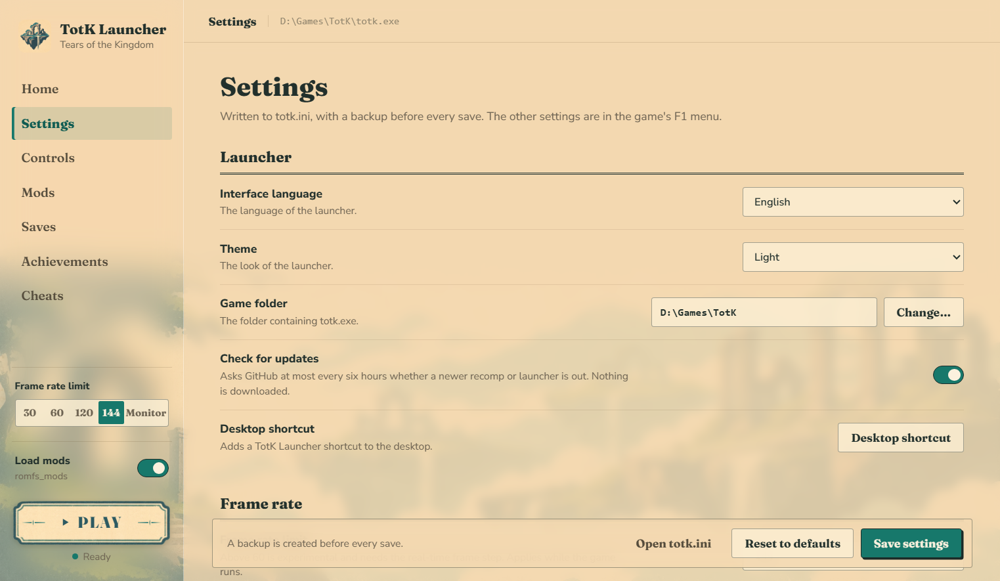
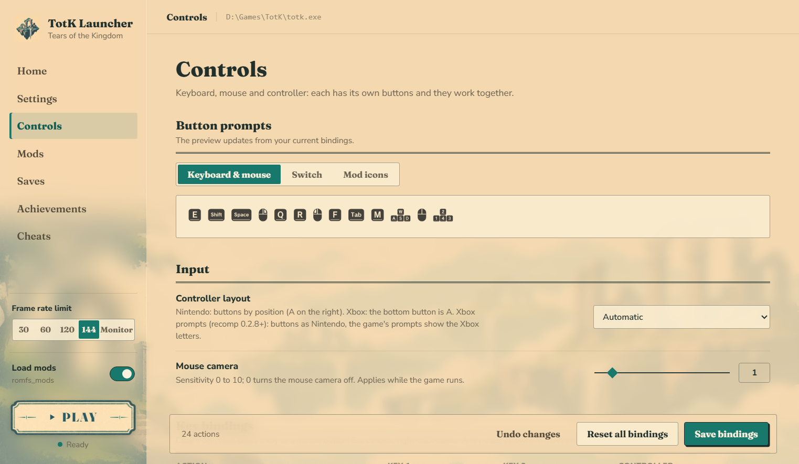
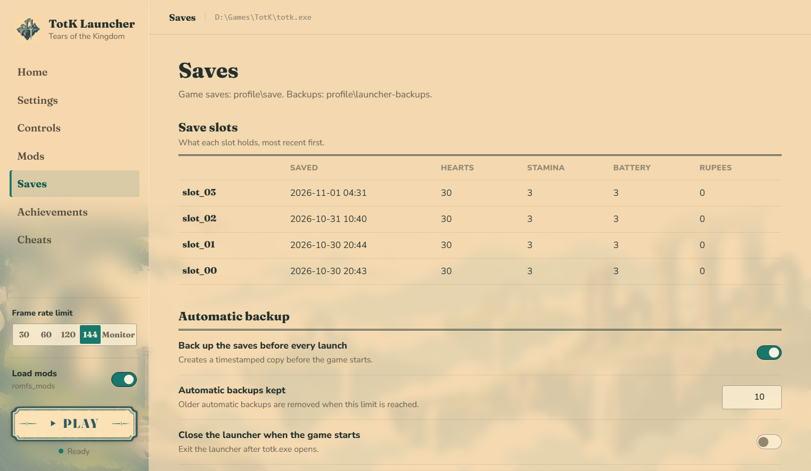
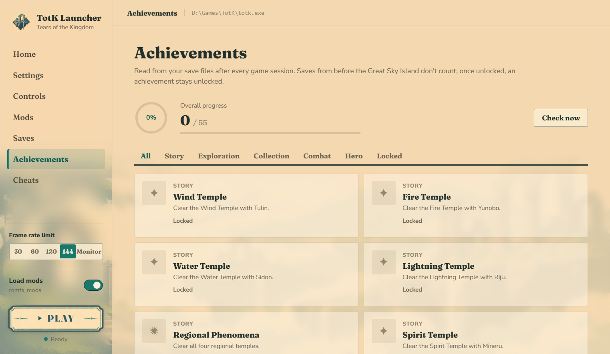

<p align="center"></p>

<h1 align="center">TotK Launcher</h1>

<p align="center">
  A launcher for the <b>Tears of the Kingdom PC recomp</b>: settings, key rebinding, keyboard &amp; mouse button prompts,
  a mod list, achievements, play time, save backups and cheats, in one window.<br>
  <a href="https://github.com/FurkanAnc/totk-launcher/releases/latest"><b>Download the latest release</b></a>
</p>



## About

The PC recomp of Tears of the Kingdom is configured through `totk.ini` and environment variables, and its button icons
are the Switch ones. TotK Launcher puts all of that in one place:

- set the frame rate, resolution, upscaler and other options without editing `totk.ini` by hand,
- rebind every button on keyboard, mouse and controller,
- see **your own keys** in the game instead of A / B / X / Y, the action prompt in the corner included,
- keep several mods side by side and switch each one on or off,
- track 55 achievements read from your saves, and your play time,
- back up and restore saves, and tweak rupees, hearts, stamina and battery,
- hear about a new recomp or launcher release.

It runs on Windows 10 and 11, in English or Turkish (Settings > Interface language). It ships **no game files**: the
little it needs for the button icons is read from your own installation.

## Screenshots

| Settings | Controls |
|---|---|
|  |  |
| **Saves** | **Achievements** |
|  |  |

## Features

- **Home**: the installed version, graphics card and mods in one line, the frame rate of your last session (average
  and 1% low, from the game's own log), your total play time and a note when a newer recomp or launcher is out. The
  frame rate limit and the mods switch are in the sidebar on every page.
- **Themes**: Light (default) or Night, in Settings > Launcher.
- **Settings**: frame rate, display, picture and camera, language, sound and input options, written to `totk.ini`
  without touching its comments (a backup is taken before every save). The options of recomp 0.2.8 are there too:
  picture shape (fit or stretch), field of view, colour profile, brightness, contrast, saturation and gamma, stick dead
  zone, rumble strength and trigger rumble. At the bottom: the latest game log.
- **Controls**: rebind keyboard, mouse and controller buttons (click a cell, press a key or a mouse button), controller
  layout (Automatic, Nintendo, Xbox, or Xbox prompts on recomp 0.2.8) and mouse camera sensitivity. Writes the game's
  own `bind_*` lines.
- **Mods**: put each mod in its own folder in `mods` next to `totk.exe` (or use Add a mod folder) and switch them on
  or off. When you press PLAY they are combined with `romfs_mods` in a copy; a mod lower in the list wins when two
  change the same file, and the page says which mod replaces whose files. `romfs_mods` itself is never changed.
- **Button prompts**: the in-game button icons can show your **keyboard and mouse** keys (drawn from your bindings,
  the action prompt in the corner included), the original **Switch** icons, or the icons of a font mod in
  `romfs_mods`.
- **Achievements**: 55 achievements in five categories (story, exploration, collection, combat, hero), read from
  your saves after every session: temples, shrines, Lightroots, Korok seeds, caves, wells, bosses, Lynels, Flurry
  Rushes, the Compendium and more. A popup shows new ones; saves from the prologue do not count. Your play time is
  added up from the game's log after every session.
- **Saves**: what each save slot holds (saved time, hearts, stamina, battery, rupees), automatic backup before every
  launch, manual backups, restore.
- **Cheats**: rupees, hearts, stamina wheels and battery cells in a save slot (while the game is closed).

## Install

You need the Tears of the Kingdom PC recomp already installed (the folder with `totk.exe` and `romfs`), on Windows 10
or 11 (the window uses Microsoft Edge WebView2, which they include).

1. Download `TotK Launcher.exe` from the [latest release](https://github.com/FurkanAnc/totk-launcher/releases/latest).
2. Start it. Then either:
   - **Put it in the game folder**, next to `totk.exe`: it finds the game by itself, or
   - **Start it from anywhere** (Downloads, Desktop…): the first time it asks you to select `totk.exe` and
     remembers the folder. Settings > Launcher > Game folder changes it later.
3. Press **PLAY**. Settings > Launcher > Desktop shortcut adds a shortcut.

Windows SmartScreen may warn about an unknown publisher the first time, since the exe is not signed: choose
"More info" > "Run anyway".

## How the button prompts work

When you press PLAY the launcher reads what it needs from your own extracted RomFS (`romfs\index.json` and
`romfs\romfs.bin`: the zstd dictionaries, the button font, the Common layout archive, the message archive of your game
language and the resource size table), redraws the prompts and writes the result to `launcher\rt\mods` and
`launcher\rt\patches` in the game folder. The game is started with `TOTK_ROMFS_MODS` and `TOTK_ROMFS_PATCHES` pointing
there. Your own `romfs_mods` and `romfs-patches` folders are copied, never changed.

The first launch after a change takes about 10 seconds; later launches reuse the result.

## Files it creates

In the game folder:

| Path | What |
|---|---|
| `launcher\launcher.json` | launcher options, unlocked achievements and play time |
| `launcher\ini-backups\` | the last 10 copies of `totk.ini` |
| `launcher\rt\` | the prompt overlays and the combined mods (safe to delete) |
| `mods\` | your mod library, one folder per mod (made when you add a mod) |
| `profile\launcher-backups\` | save backups |

And `%APPDATA%\TotK Launcher\location.json`: the game folder, when the exe is not in it.

The update check asks the GitHub API for the latest release of the recomp and of the launcher, at most every six hours,
and downloads nothing. Settings > Launcher > Check for updates turns it off.

To uninstall, delete `TotK Launcher.exe`, the `launcher` folder in the game folder and `%APPDATA%\TotK Launcher`.

## Building from source

With Python 3.10+ on Windows:

```
pip install -r launcher\requirements.txt pyinstaller
launcher\build_exe.cmd
```

The exe is written to `launcher\dist`. `python launcher\launcher.pyw` runs it without building (put the `launcher`
folder next to `totk.exe`, or select the game on the first start).

The code: `launcher.pyw` (window and the API the page calls), `ui/` (the page: HTML, CSS, JavaScript), `core.py`
(settings, saves, cheats, mods, play time, update check, starting the game), `prompts.py` (bindings and button prompts), `achievements.py`, `paths.py`
and `i18n.py`.

## Türkçe

Tears of the Kingdom PC recomp için launcher: ayarlar (recomp 0.2.8'in görüş alanı, renk ve görüntü oranı ayarları dahil),
tuş atama, oyunda klavye/fare tuş simgeleri (aksiyon simgesi dahil), tek tek açılıp kapatılabilen mod listesi, 55
başarım, oynama süresi, kayıt yuvası bilgisi, kayıt yedekleme, hileler ve yeni sürüm bildirimi. Açık ve gece teması
var. [Son sürümden](https://github.com/FurkanAnc/totk-launcher/releases/latest)
`TotK Launcher.exe`'yi indirin; `totk.exe`'nin yanına koyun ya da herhangi bir yerden açıp `totk.exe`'yi seçin. Arayüz
dili Settings > Interface language'dan Türkçe yapılabilir.

## Credits

The achievement flag lists (`launcher/achievement_data.json`) come from the
[Zelda: Tears of the Kingdom savegame editor](https://github.com/marcrobledo/savegame-editors) by Marc Robledo, with
research by MacSpazzy, Phil, savage13, Karlos007, Echocolat and MrCheeze. MIT License, Copyright (c) 2017-2023 Marc
Robledo.

Fonts: [Fraunces](https://fonts.google.com/specimen/Fraunces) and
[Nunito Sans](https://fonts.google.com/specimen/Nunito+Sans), SIL Open Font License (`launcher/ui/fonts`).

The pictures in `launcher/ui/img` (the backgrounds, the PLAY plate and the app icon) were made for this launcher; it
uses no logo or picture from the game.

## License

MIT, see [LICENSE](LICENSE). Not affiliated with Nintendo; The Legend of Zelda: Tears of the Kingdom is a trademark of
Nintendo.
